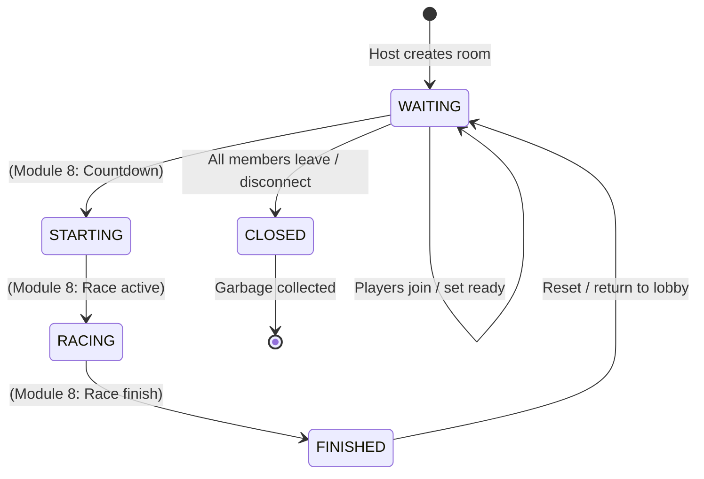

# Module 5: Lobby, Rooms, and Player Assignment

This document specifies the lobby and room management architecture for the AISR Multiplayer Robot Racing Simulator backend.

---

## 1. Overview and Architecture

The room management layer enables connected WebSocket sessions to create, discover, join, and leave private or public race rooms using human-friendly room codes.

### Core Guarantees:
- **Server-Authoritative Room State:** Room IDs, codes, player membership, readiness flags, and robot assignments are determined and maintained strictly in memory on the server.
- **Atomic Concurrency Protection:** Room capacity checks and robot reservations are executed under asynchronous mutex locks, preventing oversold room capacity or double-booked robot instances.
- **Single-Room Constraint:** A connected player session can belong to at most one room simultaneously.
- **1:1 Robot Assignment:** Each driver in a room is allocated exactly one robot from the `RobotRegistry`. Spectator members do not consume robot instances.
- **Deterministic Owner Transfer:** When a room host departs, ownership is deterministically transferred to the next longest-connected member in the room. When all members depart, the room is automatically closed and removed.
- **Zero Cross-Room Leakage:** Room notifications, player joins, ready updates, and robot assignments are strictly scoped to authenticated members of that specific room.

---

## 2. Room Code Format and Lifecycle

### Room Code Generation
- **Format:** 5-character uppercase alphanumeric string (e.g. `K9X2P`, `7RN4B`).
- **Alphabet:** Characters `23456789ABCDEFGHJKLMNPQRSTUVWXYZ` ($28$ characters).
  - Ambiguous characters `0`, `O`, `1`, and `I` are excluded to prevent transcription errors.
  - Generated using cryptographically secure `secrets.choice()`.
  - Guaranteed unique among all active rooms.

### Room Lifecycle States (`RoomStatus`)


- `WAITING`: Open lobby state. Players can join as drivers or spectators, toggle readiness, or view roster.
- `STARTING` / `RACING` / `FINISHED`: Reserved for Module 8 (Race Lifecycle).
- `CLOSED`: Room is vacated and removed from the active room catalog.

---

## 3. Robot Assignment Policy

1. **Registry Integration:**
   - Driver assignments query the authoritative `RobotRegistry` from Module 3.
   - A robot is available if `robot.is_available is True` and `robot.assigned_player_id is None`.
2. **Atomic Reservation:**
   - Upon join or creation as `"driver"`, the server immediately marks `robot.assigned_player_id = session.session_id` and `robot.is_available = False`.
   - The server issues a `robot_assigned` message to the driver with their assigned `robot_id`.
3. **Capacity vs. Available Robots:**
   - If a room has configured capacity (e.g. 4), but the simulation registry has fewer available robots (e.g. only 2 available), drivers 1 and 2 are assigned robots.
   - Driver 3 attempting to join receives structured error `ERR_NO_ROBOTS_AVAILABLE`.
   - A player joining as `"spectator"` bypasses robot assignment and can join as long as room capacity permits.
4. **Reservation Release:**
   - When a member leaves or disconnects, their assigned robot is released: `robot.assigned_player_id = None`, `robot.is_available = True`.
   - The robot becomes instantly available for subsequent room joins.
5. **Handling Faulted / Unavailable Robots:**
   - If an assigned robot becomes unavailable externally in the simulation, the server clears the member's robot assignment (`robot_id = None`) and broadcasts a `robot_unavailable` notification to the room.
   - The server **does not** silently reassign a different robot.

---

## 4. Disconnect and Owner-Departure Policy

When a player disconnects or sends a `leave_room` request:
1. **Member Removal:** The player is unlinked from the room's member roster and reverse index.
2. **Robot Release:** Any robot reserved by that player is returned to the pool.
3. **Peer Preservation:** The robot assignments, readiness states, and positions of all remaining room members are preserved without alteration.
4. **Owner Migration:**
   - If the departing player is the room owner and other members remain, ownership is promoted to the first remaining member in join order.
   - If no members remain, the room transitions to `CLOSED` and is pruned from memory.
5. **Idempotence:** Disconnect and leave handlers are fully idempotent; repeated invocations produce no side effects or errors.

---

## 5. Protocol Message Specification

### 5.1 Client -> Server Messages

#### `create_room`
Creates a new room. The creator is designated as host/owner.
```json
{
  "v": 1,
  "type": "create_room",
  "seq": 1,
  "ts": 1730000001.0,
  "session_id": "sess_a1b2c3d4e5f6",
  "name": "Grand Prix 1",
  "capacity": 4,
  "role": "driver",
  "display_name": "Racer Alpha"
}
```

#### `join_room`
Joins an existing room by 5-character `room_code` (e.g. `ABC23`) or internal `room_id`.
```json
{
  "v": 1,
  "type": "join_room",
  "seq": 1,
  "ts": 1730000002.0,
  "session_id": "sess_f6e5d4c3b2a1",
  "room_id": "ABC23",
  "display_name": "Racer Beta",
  "role": "driver"
}
```

#### `leave_room`
Leaves the current room.
```json
{
  "v": 1,
  "type": "leave_room",
  "seq": 5,
  "ts": 1730000050.0,
  "session_id": "sess_f6e5d4c3b2a1",
  "room_id": "room_12345"
}
```

#### `set_ready`
Updates the calling driver's readiness state in their current room.
```json
{
  "v": 1,
  "type": "set_ready",
  "seq": 3,
  "ts": 1730000010.0,
  "session_id": "sess_a1b2c3d4e5f6",
  "room_id": "ABC23",
  "is_ready": true
}
```

#### `list_rooms`
Requests a catalog of active, joinable rooms.
```json
{
  "v": 1,
  "type": "list_rooms",
  "seq": 2,
  "ts": 1730000005.0,
  "session_id": "sess_a1b2c3d4e5f6"
}
```

---

### 5.2 Server -> Client Messages

#### `room_snapshot`
Sent to players upon joining or whenever room state changes.
```json
{
  "v": 1,
  "type": "room_snapshot",
  "seq": 10,
  "ts": 1730000003.0,
  "room_id": "room_89abc",
  "room_code": "ABC23",
  "name": "Grand Prix 1",
  "owner_id": "sess_a1b2c3d4e5f6",
  "capacity": 4,
  "status": "WAITING",
  "members": [
    {
      "session_id": "sess_a1b2c3d4e5f6",
      "display_name": "Racer Alpha",
      "role": "driver",
      "robot_id": "robot_1",
      "is_ready": true,
      "is_owner": true,
      "joined_at": 1730000001.0
    },
    {
      "session_id": "sess_f6e5d4c3b2a1",
      "display_name": "Racer Beta",
      "role": "driver",
      "robot_id": "robot_2",
      "is_ready": false,
      "is_owner": false,
      "joined_at": 1730000002.0
    }
  ]
}
```

#### `robot_assigned`
Sent to a driver when a robot is reserved for their session.
```json
{
  "v": 1,
  "type": "robot_assigned",
  "seq": 11,
  "ts": 1730000002.5,
  "room_id": "room_89abc",
  "session_id": "sess_f6e5d4c3b2a1",
  "robot_id": "robot_2"
}
```

#### `player_joined`
Broadcast to existing room members when a new player enters.
```json
{
  "v": 1,
  "type": "player_joined",
  "seq": 12,
  "ts": 1730000002.5,
  "room_id": "room_89abc",
  "session_id": "sess_f6e5d4c3b2a1",
  "display_name": "Racer Beta",
  "role": "driver",
  "robot_id": "robot_2"
}
```

#### `player_left`
Broadcast to remaining room members when a player departs.
```json
{
  "v": 1,
  "type": "player_left",
  "seq": 15,
  "ts": 1730000050.5,
  "room_id": "room_89abc",
  "session_id": "sess_a1b2c3d4e5f6",
  "reason": "Player left room",
  "new_owner_id": "sess_f6e5d4c3b2a1"
}
```

#### `player_ready`
Broadcast to room members when a member updates readiness.
```json
{
  "v": 1,
  "type": "player_ready",
  "seq": 16,
  "ts": 1730000010.5,
  "room_id": "room_89abc",
  "session_id": "sess_a1b2c3d4e5f6",
  "is_ready": true
}
```

---

## 6. How to Test Multiple Clients and Rooms Locally

### Automated Testing
Execute all Module 5 room tests:
```powershell
.\.venv\Scripts\pytest.exe tests\test_multiplayer_rooms.py -v
```

Execute the full project test suite:
```powershell
.\.venv\Scripts\pytest.exe
```

---

## 7. Current Limitations and Next Steps
- **No Race Lifecycle:** Countdown, lap counting, and race state transitions are pending Module 8.
- **No Physical Motion Dispatch:** Control inputs are strictly validated at protocol level; simulation physics dispatch is implemented in Module 7.
- **No Browser UI:** Frontend Three.js canvas and lobby UI will be implemented in Module 6.
