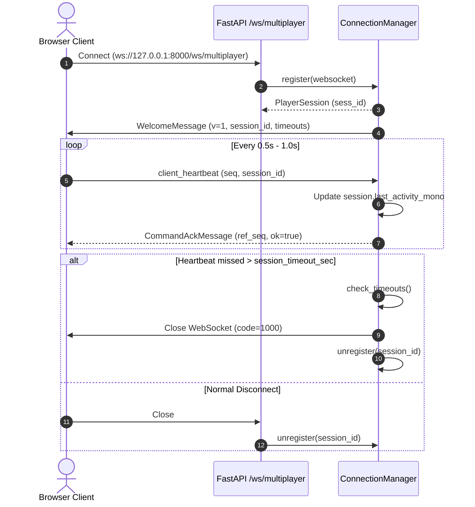

# AISR Multi-Session Connection Manager (Module 4)

This document specifies the WebSocket connection layer, session lifecycle, message processing rules, heartbeat/inactivity sweeper, and concurrency guarantees for the **Networked Multiplayer Robot Racing Simulator**.

---

## 1. Architecture & Endpoint Overview

Multiplayer browser clients connect via WebSocket to a dedicated endpoint on the FastAPI backend:

$$\text{Browser Client} \xleftrightarrow{\text{WSS / WS}} \text{FastAPI } \texttt{/ws/multiplayer} \xleftrightarrow{} \text{ConnectionManager}$$

### Core Invariants:
1. **Server-Generated Session IDs:** Every connecting client is assigned a server-generated unique ID (`sess_<uuid12>`). Client-supplied session IDs are never trusted as identity.
2. **Session Isolation:** Acknowledgements and direct messages are routed strictly to the originating session. Clients cannot listen to or inspect other clients' private streams.
3. **Non-Blocking Concurrent I/O:** The manager maintains per-session `send_lock` instances rather than a global lock, ensuring slow or disconnected clients do not block healthy clients.
4. **Clean Decoupling:** In Module 4, the connection manager handles only session lifecycle and protocol validation. Robot dispatch and room management are deferred to later modules.

---

## 2. Handshake & Session Lifecycle



### Handshake Message (`welcome`):
Sent immediately upon connection:
```json
{
  "v": 1,
  "type": "welcome",
  "seq": 1,
  "ts": 1730000000.123,
  "session_id": "sess_8f3a9b21c40e",
  "heartbeat_interval_sec": 1.0,
  "timeout_sec": 5.0,
  "server_time": 1730000000.123,
  "message": "Connected to AISR Multiplayer Server"
}
```

---

## 3. Supported Messages in Module 4

All incoming frames are validated strictly against the Module 2 protocol schemas:

| Message Type | Direction | Processing in Module 4 |
|---|:---:|---|
| `welcome` | S -> C | Sent upon connection to establish session identity. |
| `client_heartbeat` | C -> S | Refreshes `last_activity_mono`. Returns `CommandAckMessage`. |
| `player_input` | C -> S | Validated strictly. Returns `CommandAckMessage` (`ok=true`, dispatch pending Module 5). |
| `individual_stop` | C -> S | Validated strictly. Returns `CommandAckMessage`. |
| `individual_estop`| C -> S | Validated strictly. Returns `CommandAckMessage`. |
| `room_estop` | C -> S | Validated strictly. Returns `CommandAckMessage`. |
| `room_reset` | C -> S | Validated strictly. Returns `CommandAckMessage`. |
| `join_room` | C -> S | Validated strictly. Returns `CommandAckMessage`. |
| `leave_room` | C -> S | Validated strictly. Returns `CommandAckMessage`. |
| `command_ack` | S -> C | Returned to confirm accepted actions. |
| `error` | S -> C | Returned upon protocol violation or validation failure. |

---

## 4. Input Validation & Security Rules

1. **Monotonic Sequence Enforcement:**
   Every client frame must provide `seq > session.last_seq`.
   Duplicate sequence numbers (`seq == last_seq`) or out-of-order packets (`seq < last_seq`) are rejected with `ERR_OUT_OF_BOUNDS`.
2. **Session ID Spoofing Prevention:**
   If a client submits a message with a `session_id` that does not match the server-issued session ID of the underlying socket, the message is immediately rejected with `ERR_UNAUTHORIZED`.
3. **Payload Size Enforcement:**
   Frames exceeding `MP_MAX_MESSAGE_BYTES` (default 16,384 bytes) are rejected with `ERR_PAYLOAD_TOO_LARGE`.
4. **Forged Server Broadcast Rejection:**
   If a client attempts to submit server-originated frames (e.g. `robot_state`, `room_broadcast`), it is rejected with `ERR_UNAUTHORIZED`.

---

## 5. Heartbeat & Inactivity Sweeper

- **Monotonic Clock:** Idle time is calculated via `time.monotonic()` to remain resilient against system wall-clock adjustments.
- **Asynchronous Sweeper Task:** A background loop periodically runs `check_timeouts(timeout_sec)`.
- **Fault Isolation:** When an inactive client times out, only that client's WebSocket is closed and unregistered. Other active clients experience zero disruption.

---

## 6. How to Test Multiple Clients Locally

Run backend in mock mode:
```bash
python multiplayer/run_multiplayer.py --mock
```

In Python or browser console:
```javascript
// Connect Client 1
const ws1 = new WebSocket("ws://127.0.0.1:8000/ws/multiplayer");
ws1.onmessage = (event) => console.log("Client 1 RX:", JSON.parse(event.data));

// Connect Client 2
const ws2 = new WebSocket("ws://127.0.0.1:8000/ws/multiplayer");
ws2.onmessage = (event) => console.log("Client 2 RX:", JSON.parse(event.data));
```

---

## 7. Current Limitations (Deferred to Later Modules)

- **No Rooms / Lobbies yet:** Room grouping and private room codes are implemented in Module 5.
- **No Robot Assignment:** Player-to-robot mapping is implemented in Module 5.
- **No Simulation Control Dispatch:** Control inputs are strictly validated and acknowledged, but not yet applied to the simulation drivers. Simulation dispatch begins in Module 7.
