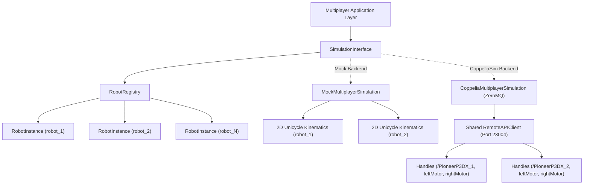

# AISR Multiplayer Simulation Abstraction & Robot Registry (Module 3)

This document describes the multi-robot simulation architecture, robot registry, kinematic control, and adapter implementations for the **Networked Multiplayer Robot Racing Simulator**.

---

## 1. Simulation Architecture

To support real-time multiplayer racing, the simulation layer decouples the application from the underlying simulator backend via `SimulationInterface`.



### Core Invariants:
1. **Explicit Robot Identity:** Every simulation operation (`apply_control`, `stop_robot`, `reset_robot`, `get_robot_state`) strictly requires an explicit `robot_id`. There is no implicit "current robot."
2. **Isolation:** Control applied to `robot_1` never modifies motor speeds or kinematics of `robot_2`.
3. **Safety Boundaries:**
   - A robot-specific stop halts only the specified robot.
   - `stop_all()` halts every registered robot.
   - Commands targeting unknown or unavailable robots fail closed (`RobotNotFoundError`, `RobotUnavailableError`).

---

## 2. Robot Registry (`RobotRegistry`)

The `RobotRegistry` (`multiplayer/simulation/robot_registry.py`) is a thread-safe registry tracking individual robot configurations, operational states, and availability.

### Key Capabilities:
- **Registration (`register(config)`):** Validates the `robot_id` against `^[a-zA-Z0-9_\-]{1,64}$` and rejects duplicate registrations.
- **Lookup (`get(robot_id)`, `require(robot_id)`):** `require` raises `RobotNotFoundError` if the robot does not exist, ensuring fail-closed semantics.
- **Safe Enumeration (`get_all_ids()`, `get_all_instances()`):** Returns defensive copies, preventing external mutation of internal registry state.
- **Availability Tracking (`set_availability(robot_id, is_available, reason)`):** Tracks physical or simulation handle health. If a robot's motor handles cannot be resolved in CoppeliaSim, it is marked unavailable and rejects motion commands.

---

## 3. Mock Multi-Robot Simulation (`MockMultiplayerSimulation`)

A deterministic, headless simulation backend for automated testing and local development without CoppeliaSim.

### Features:
- **Independent 2D Kinematics:** Computes differential-drive kinematics for each robot independently:
  $$\Delta \theta = \omega \cdot \Delta t$$
  $$\Delta x = v \cdot \cos(\theta) \cdot \Delta t$$
  $$\Delta y = v \cdot \sin(\theta) \cdot \Delta t$$
  Where $v = \text{throttle} \cdot v_{\text{max}}$ ($1.2\text{ m/s}$) and $\omega = \text{steering} \cdot \omega_{\text{max}}$ ($1.5\text{ rad/s}$).
- **Step Execution (`step(dt)`):** Allows discrete, synchronous simulation steps for reproducible unit tests without thread timing jitter.
- **Background Loop (`auto_step=True`):** Runs an internal thread loop at fixed `dt` (e.g. 50 ms / 20 Hz) for live multi-client server operation.
- **Reset:** Restores starting grid coordinates (`initial_pose`) and clears velocities.

---

## 4. CoppeliaSim Multi-Robot Adapter (`CoppeliaMultiplayerSimulation`)

Connects to a shared CoppeliaSim instance via the ZeroMQ Remote API (`coppeliasim_zmqremoteapi_client`).

### Scene Object Resolution:
For each configured robot:
- Base path: `coppelia_base_path` (default: `/PioneerP3DX_<idx>` or `/<robot_id>`)
- Left motor: `coppelia_left_motor_path` (default: `<base>/leftMotor`)
- Right motor: `coppelia_right_motor_path` (default: `<base>/rightMotor`)

### Execution Details:
- **Shared Connection:** Uses a single `RemoteAPIClient` instance to control all robots in the scene.
- **Bounded Timeouts:** Configures `zmq.RCVTIMEO` and `zmq.SNDTIMEO` to prevent server thread hangs when CoppeliaSim pauses or disconnects.
- **Motor Command Isolation:** Calls `sim.setJointTargetVelocity(robot.left_motor, wl)` and `setJointTargetVelocity(robot.right_motor, wr)` targeting exclusively that robot's joint handles.
- **Pose Telemetry:** Queries `sim.getObjectPosition(base_handle, -1)` and `sim.getObjectOrientation(base_handle, -1)`.
- **Pose Reset:** Sets robot position and orientation in simulation via `sim.setObjectPosition` and `sim.setObjectOrientation` and zeroes joint velocities.

---

## 5. Configuration Reference

In `multiplayer/config.py`:

```python
staggered_grid = [
    (0.0, 0.0, 0.0),    # robot_1: Row 1 Left
    (0.0, 1.0, 0.0),    # robot_2: Row 1 Right
    (-1.5, 0.0, 0.0),   # robot_3: Row 2 Left
    (-1.5, 1.0, 0.0),   # robot_4: Row 2 Right
]
```

Environment variables:
- `MP_SIM_MODE`: `mock` (default) or `coppelia`.
- `COPPELIA_HOST`: `127.0.0.1` (default).
- `COPPELIA_PORT`: `23004` (default).
- `MP_SIM_TIMEOUT_SEC`: `1.0` (default).

---

## 6. How to Run & Verify

### Running in Headless Multi-Robot Mock Mode:
```bash
python multiplayer/run_multiplayer.py --mock
```

### Running with Live CoppeliaSim (Multi-Robot):
1. In CoppeliaSim, load a scene containing multiple Pioneer P3-DX robots named `/PioneerP3DX_1`, `/PioneerP3DX_2`, etc.
2. Start simulation in CoppeliaSim.
3. Start backend:
   ```bash
   python multiplayer/run_multiplayer.py --coppelia
   ```

### Known Simulator Limitations & Status:
- **Automated Verification:** The CoppeliaSim adapter was verified using an isolated fake ZeroMQ remote API fixture in `tests/test_multiplayer_simulation.py` covering multi-robot handle resolution, motor isolation, and missing object failures.
- **Live Simulator Status:** Real CoppeliaSim integration verification remains pending actual live simulation environment execution.
