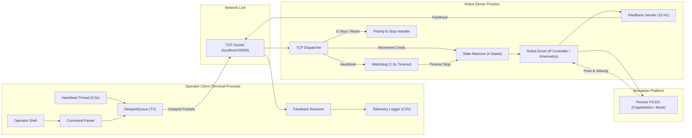

# Networked Robot Teleoperation through Shell Commands

**Course:** CSAI4014 Algorithms for Intelligent Systems and Robotics (AISR)  
**Program:** B.Tech CSE (AI & ML), Semester VII  
**Platform:** Python 3.11+, TCP Sockets, ZeroMQ Remote API, CoppeliaSim (Pioneer P3-DX)

---

## 1. Project Overview

This project implements a robust networked teleoperation system that allows an operator to remotely steer a mobile robot (Pioneer P3-DX) inside a simulated environment (CoppeliaSim) using terminal commands sent over a TCP connection.

To reflect real-world industrial teleoperation (such as in nuclear plants, hazardous chemical handling, and space exploration), the system integrates:
1. **Periodic Heartbeat Watchdog (0.5 s interval, 1.5 s timeout):** Automatically halts the robot if the communication link fails.
2. **Latched Emergency Stop (E-Stop):** Highest-priority safety override that halts the robot immediately and locks it until an explicit `reset` command is issued.
3. **Controlled Network Delay Study:** Analyzes closed-loop control degradation under simulated delays of **0, 100, 300, 500, and 1000 ms**.

---

## 2. System Architecture



---

## 3. Finite State Machine

The robot operates strictly within 4 deterministic states:

| State | Description | Accepts Movement Commands? |
|---|---|:---:|
| `IDLE` | Connected, waiting for motion commands. | **Yes** |
| `MOVING` | Currently executing trajectory or driving. | **Yes** |
| `COMM_LOST` | Heartbeat missed for > 1.5 s. Robot stopped. | **No** (until heartbeats resume & fresh command arrives) |
| `ESTOP_LATCHED` | Emergency stop active. Robot locked. | **No** (until explicit `reset` command) |

> **Safety Invariant:** E-Stop overrides every other state. When recovering from `COMM_LOST`, the robot **never** auto-resumes previous motion; a new command is strictly required.

---

## 4. Operator Command Reference

| Command | Arguments | Example | Description |
|---|---|---|---|
| `forward` | `<speed>` (m/s) | `forward 0.4` | Drive straight forward (up to 1.2 m/s). |
| `back` | `<speed>` (m/s) | `back 0.3` | Drive straight backward. |
| `left` | `<angle_deg>` | `left 90` | Turn left in-place by specified degrees. |
| `right` | `<angle_deg>` | `right 90` | Turn right in-place by specified degrees. |
| `goto` | `<x> <y>` | `goto 1.5 1.0` | Closed-loop navigation to target coordinates. |
| `stop` | None | `stop` | Stop motion normally. |
| `status` | None | `status` | Query current pose $(x, y, \theta)$ and state. |
| `estop` | None | `estop` | **Emergency stop**: halts immediately and locks. |
| `reset` | None | `reset` | Unlocks robot from `ESTOP_LATCHED`. |
| `delay` | `<ms>` | `delay 300` | Dynamically update artificial network delay. |
| `pause_hb` | None | `pause_hb` | Simulate link failure by stopping heartbeats. |
| `resume_hb` | None | `resume_hb` | Resume sending heartbeats after link failure test. |

---

## 5. Installation & Quick Start

### Step 1: Clone Repository & Create Virtual Environment
```bash
git clone https://github.com/soumya-jain123/AISR-Project.git
cd AISR-Project

# Create and activate virtual environment
python -m venv .venv
.\.venv\Scripts\activate   # Windows
# source .venv/bin/activate # Linux / macOS

# Install dependencies
pip install -r requirements.txt
```

### Step 2: Run Unit Tests
```bash
pytest -v
```
All tests verify protocol framing, priority dispatching, watchdog timeouts, and delay accuracy.

### Step 3: Launch System

#### Mode A: Headless / Mock Driver Mode (No simulator required)
```bash
# Terminal 1 - Start Robot Server in mock mode:
python server/run_server.py --mock

# Terminal 2 - Start Operator Client:
python client/operator_client.py
```

#### Mode B: With CoppeliaSim (Pioneer P3-DX)
1. Launch **CoppeliaSim**.
2. Open or drag `models/robots/mobile/pioneer p3dx.ttm` into the scene.
3. Start the simulation in CoppeliaSim (Play button).
4. Run the server:
   ```bash
   python server/run_server.py
   ```
5. In another terminal, run the operator client:
   ```bash
   python client/operator_client.py
   ```

---

## 6. Running Network Delay Experiments

Automated sweeps over `[0, 100, 300, 500, 1000]` ms:

```bash
# Run automated experiment suite (repeats each test across all delays)
python experiments/run_experiments.py --reps 3

# Generate analysis plots, trajectory curves, and report table
python experiments/analyze.py
```

Generated deliverables are saved in `results/`:
- `plot_delay_vs_error.png`: Position error and overshoot vs. network latency.
- `plot_delay_vs_timing.png`: E-Stop reaction latency and task completion time.
- `plot_trajectories.png`: Overlaid 2D paths showing wobbling and overshoot.
- `results_table.md`: Quantitative table ready for the final report.

---

## 7. Project Structure

```
AISR-Project/
├── common/
│   ├── config.py           # System-wide constants, ports, states
│   ├── protocol.py         # Line-delimited JSON schemas & stream framer
│   └── netdelay.py         # Repeatable OS-independent artificial delay queue
├── server/
│   ├── driver_interface.py # Abstract robot interface
│   ├── state_machine.py    # 4-state safety logic & transition validator
│   ├── watchdog.py         # 1.5 s heartbeat watchdog thread
│   ├── mock_driver.py      # Kinematic simulation for headless testing
│   ├── sim_driver.py       # CoppeliaSim Pioneer P3-DX ZeroMQ driver
│   ├── robot_server.py     # TCP server with priority E-Stop dispatch
│   └── run_server.py       # Server entrypoint with auto-fallback
├── client/
│   ├── heartbeat.py        # 0.5 s periodic heartbeat sender thread
│   ├── logger.py           # CSV telemetry & timestamp logger
│   └── operator_client.py  # Interactive terminal shell & API
├── experiments/
│   ├── run_experiments.py  # Automated parameter sweep test harness
│   └── analyze.py          # Matplotlib visualizations & table generator
├── scenes/
│   └── setup_scene.py      # CoppeliaSim scene verification script
├── tests/
│   ├── test_protocol.py    # Packet encoding, schemas, framer tests
│   ├── test_netdelay.py    # Delay queue timing tests
│   ├── test_server_core.py # State machine, watchdog, and TCP tests
│   └── test_client.py      # Client-server integration tests
├── docs/
│   ├── MEETING_LOG.md      # Team meeting logs for Report Appendix
│   └── CONTRIBUTIONS.md    # Contribution & writing allocation tables
├── results/                # CSV data logs and generated figures
├── IMPLEMENTATION_PLAN.md  # Detailed module-by-module breakdown
├── requirements.txt        # Frozen Python dependencies
└── README.md               # Project documentation
```
